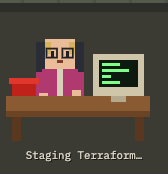
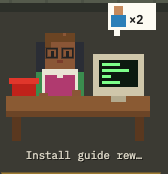
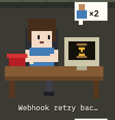
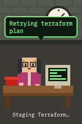
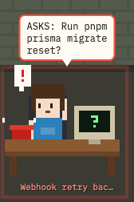
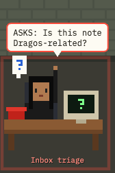
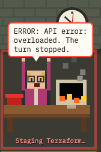
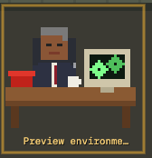
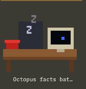

# The AI Crowd

A fun overview of all your Claude Code agents in cmux, drawn as a pixel-art IT basement. See every agent at a glance, spot the ones that need your input, and click (or press Enter) to jump straight to that agent's cmux pane.

It uses no AI and spends no tokens. It reads the files Claude Code already writes, plus events from the optional plugin's hooks, which are plain shell commands.

## Who's in the office

| | |
|---|---|
|  | **Working.** Typing away. Nothing for you to do. |
|  | **Working, with helpers.** The badge counts its subagents. Hover it for their names. |
|  | **Waiting on helpers.** Watching the hourglass until its helpers report back. Nothing for you to do yet. |
|  | **Chatter.** When an agent starts something new or finishes, a bubble pops up for a few seconds to say what. The CHATTER switch on the wall turns it off. |
|  | **Needs permission.** The red phone rings and the bubble says what it wants to run. Needs you. |
|  | **Asked a question.** Hand up, with the question in the bubble. Needs you. |
|  | **Error.** An API error stopped the turn, and the monitor is on fire. Needs you. |
|  | **Finished.** Leaning back with tea until you look at the result. Falls asleep 30 minutes after you look, or after 2 hours if you never do. |
|  | **Finished, with a shell running.** Gears turn on the monitor while a background shell still runs, such as a dev server or a wait on a deploy. The agent may or may not be waiting on it, so it still counts as Finished. Hover the screen to see what's running. |
|  | **Asleep.** Nothing new for a while. |

## Install

You need macOS, [cmux](https://cmux.com), Claude Code, and Node 26 or newer. There are no packages to install.

```sh
git clone git@github.com:Farmer-Pete/the-AI-crowd.git
cd the-AI-crowd
npm start
```

Run `npm start` from a cmux terminal so The AI Crowd can switch cmux panes. Then open <http://localhost:4747>, or <http://localhost:4747/demo> to see it with demo agents. To see only some states, add `?only=` with a comma-separated list, such as `/demo?only=review,shells`. Use the state names from `src/types.ts`. `shells` picks the desks with a background shell running.

For exact states (permission vs. question, API errors), install the Claude Code plugin. In Claude Code:

```
/plugin marketplace add Farmer-Pete/the-AI-crowd
/plugin install the-ai-crowd@the-ai-crowd
```

## Put it in the cmux Dock

```sh
cmux new-pane --type browser --placement dock --url http://localhost:4747
```

In the Dock, ⌥⌘B shows or hides it, and ⇧⌘E focuses it with the top agent already picked. ↑↓ pick an agent, and Enter jumps to it. Those are cmux's default keys. The Dock shows yours if you changed them.

## Working on it

Running The AI Crowd needs nothing installed. The checks do:

```sh
npm install
git config core.hooksPath .githooks
```

After that, every commit runs `npm run check`: the TypeScript compiler, oxlint, knip for unused code, jscpd for copy-paste, a scan for comments that switch a check off, and the tests. `any`, `!` assertions, and empty `catch` blocks fail the commit. `.npmrc` turns off install scripts, so `npm install` runs no package code.

## License

[MIT](LICENSE)
